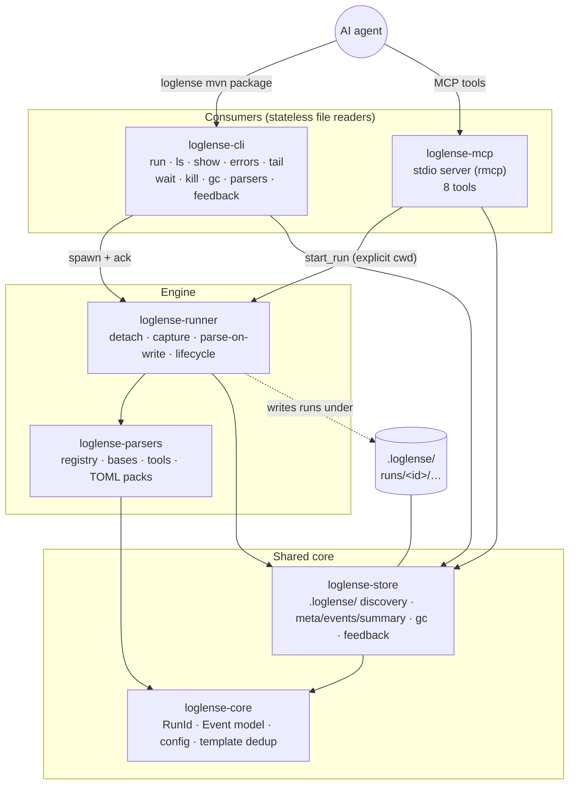
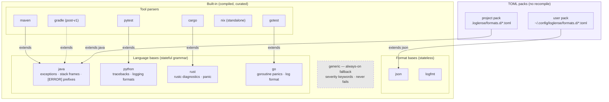
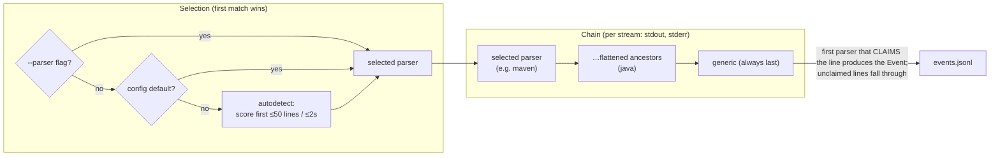
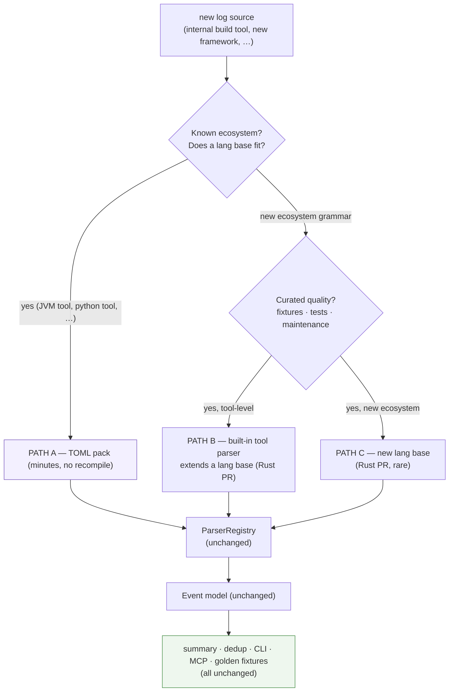
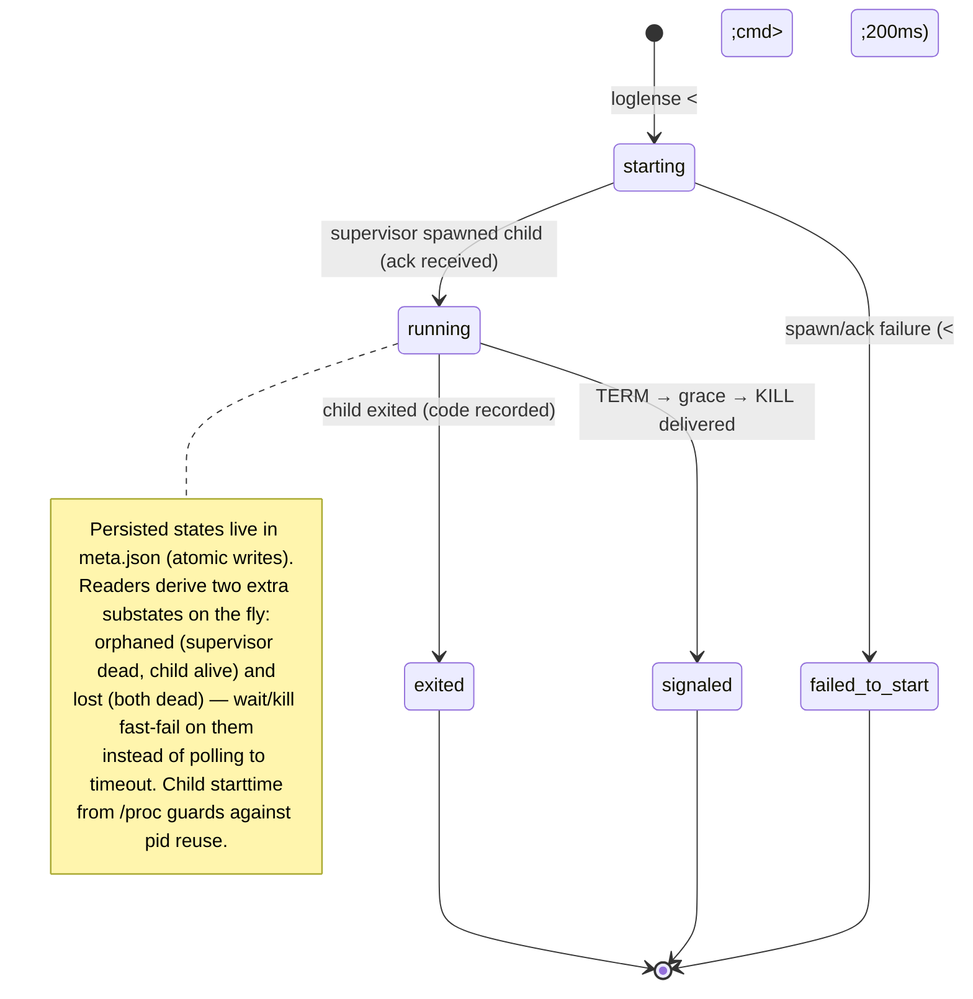
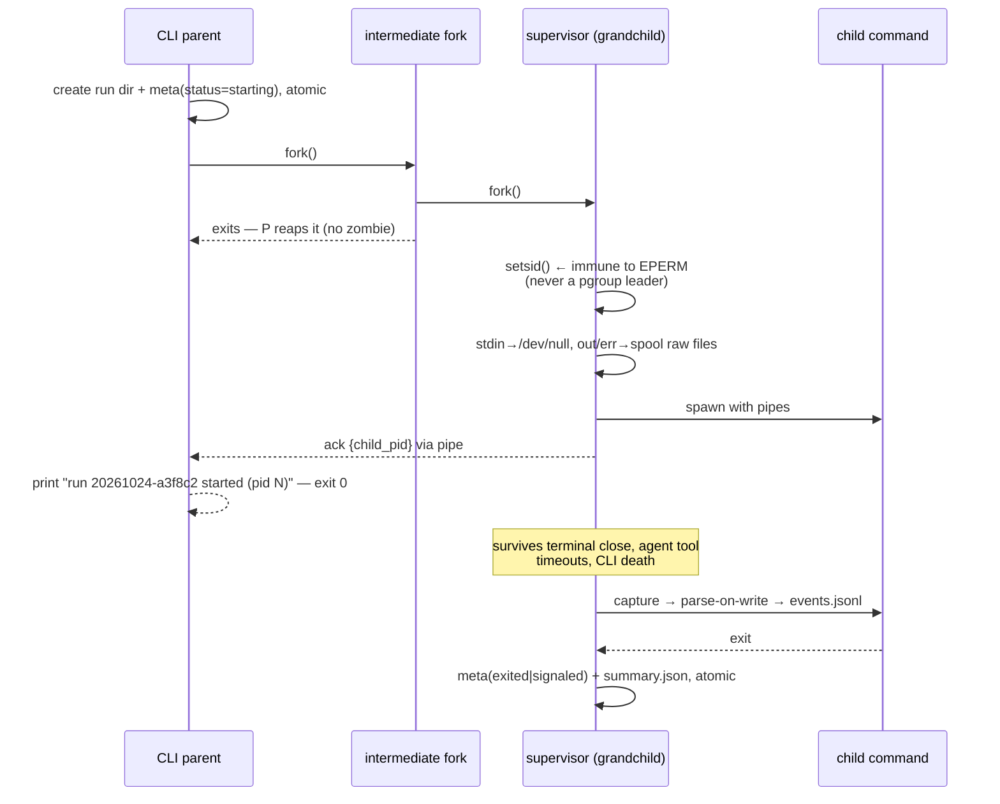
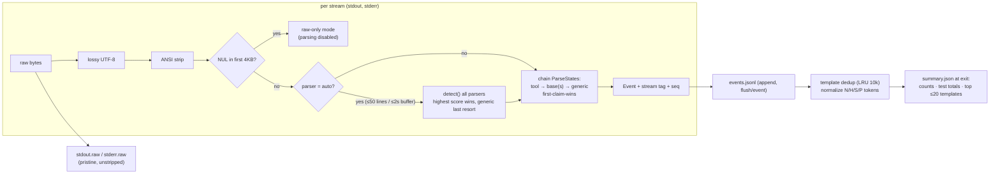
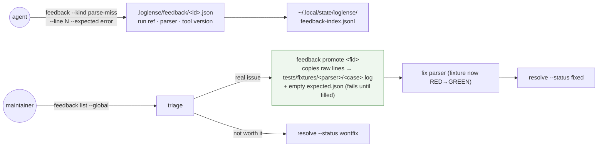

# loglense — Architecture

Status: **approved design** (2026-10-24) · Companion docs (planned): `requirements.md`, `decisions.md`, `parsers.md`, `surfaces.md`

loglense is a `time`-style command wrapper for AI agents: put it in front of any command, get an instant run ID back, then query short, structured, bounded results (summaries, errors, warnings, test totals, tails) via CLI or MCP — instead of `cat`/`tail`-ing raw logs into the agent's context window.

---

## 1. Design principles

| # | Principle | Consequence |
|---|-----------|-------------|
| P1 | **Daemonless — the filesystem is the state** | No service lifecycle, no sockets, no locks (except gc/feedback). Every consumer is a pure file reader over `.loglense/`. Crash-tolerant by construction. |
| P2 | **Parse once, on write** | The detached runner parses as it captures. Downstream surfaces (CLI, MCP, fixtures) only ever read normalized events — never re-parse raw logs. |
| P3 | **The Event model is the only contract** | Parsers are *producers* of `Event`s. Every consumer (summary, dedup, CLI, MCP, golden fixtures) is parser-agnostic. Adding a log source never touches a consumer. |
| P4 | **Bounded output everywhere** | Every read surface has a default cap (lines/bytes/events). Protecting agent context windows is a hard invariant, not a nicety. |
| P5 | **Modular by inheritance** | Language bases (java, python, rust, go) own ecosystem grammar; tool parsers `extend` them; TOML packs `extend` anything — same mechanism at every level. |
| P6 | **One static binary** | Pure-Rust dependency tree, musl-static builds. Copy one file to any Linux machine — CLI and MCP are the same binary. |
| P7 | **Push beats poll — but poll stays** | An optional completion callback, fired by the supervisor itself, can ping the calling agent when results are ready (§7). Polling (`wait`) remains the universal, always-available fallback. |

---

## 2. System overview



**Allowed crate dependency edges (enforced by review):** `core ← parsers`, `core ← store`, `runner → {parsers, store, core}`, `cli → {runner, store, parsers, core}`, `mcp → {runner, store, parsers, core}`. There is **no** `cli ↔ mcp` edge and no cycles — `core` depends on nothing in the workspace.

---

## 3. The parser module system

*This is the heart of loglense's modularity. Everything downstream of the registry sees only the `Event` model (P3), so the registry is the single extension point for new log sources.*

### 3.1 Module hierarchy

Three kinds of modules, one inheritance mechanism (`extends`), resolved by name at registry build time:



**What a lang base owns:** the ecosystem's shared multi-line grammar — e.g. `java` knows what an exception header, a `at com.foo.Bar(Bar.java:42)` frame, and a `Caused by:` chain look like; `python` knows the `Traceback (most recent call last):` block shape. A tool parser inherits all of that and adds only tool-specific rules (maven's `Tests run: …` summaries, pytest's `=== short test summary ===`). This is why *maven logs with embedded NPE stack traces parse correctly with zero stack-trace code in the maven parser*.

### 3.2 The module contract

Every module — compiled or TOML — satisfies the same six-part contract (declared once in `loglense-core`, implemented identically by built-ins and packs):

| Contract element | Meaning |
|---|---|
| **Identity** | A unique name under which the module registers ("maven", "mytool"). |
| **Inheritance** | An optional parent, declared *by name* — the `extends` relation. Resolved at registry build time; cycles and unknown parents are load-time errors, never parse-time surprises. |
| **Detection** | A confidence score (0–100) computed over a sample of the run's first ~50 lines. Feeds autodetection (§3.3). |
| **Per-run state** | A fresh parsing state created for every run — and separately for every stream — so concurrent runs and streams never share mutable state. |
| **Line intake** | Lines arrive one at a time; the module may *buffer* while a multi-line block (stack trace, diagnostic) is open, emitting nothing until the block completes. |
| **Flush** | At end of stream, any still-open partial block is flushed as a best-effort event. |

**Statefulness is the key design point.** One event per *logical block*: a Java exception arrives as one event with its frames attached, not forty line-events. Summaries stay agent-sized even when stack traces are hundreds of lines.

### 3.3 Chain construction

A run uses one parser *chain*: the selected parser, its flattened inheritance ancestors (base first), and `generic` always last:



- `extends` resolution: name-based DFS at registry build; cycles and unknown parents are rejected at load (never at parse time).
- Name precedence on collision: **project pack > user pack > built-in** — a project can override a built-in parser by shipping a pack with the same name.
- A broken pack (bad regex, unknown field, cyclic `extends`) is reported to stderr naming `file:field` and **skipped** — it can never kill a run.
- One `ParseState` per stream: stdout and stderr blocks never interleave mid-block; events carry a `stream` tag and a monotonic `seq`.

### 3.4 Adding a new log source — the three paths

This is the extensibility guarantee. **Nothing downstream of the registry changes, ever** — new sources plug in at exactly one seam (the registry) and produce the same `Event`s everyone already consumes:



**PATH A — TOML pack (the 5-minute path, no recompilation):** a pack is a small declarative file dropped into the project's formats directory (or the user's global one). Its grammar:

| Section | Field | Meaning |
|---|---|---|
| header | schema | pack grammar version (currently 1) — strict parsing, unknown fields rejected |
| header | name | module name; a project pack may intentionally shadow a built-in |
| header | extends | optional parent module to inherit grammar from (e.g. the java base) |
| detect | pattern | line pattern that, seen repeatedly, identifies this format |
| detect | min score | how many matching lines convince the detector |
| rule (ordered list) | id | stable rule identifier; a child rule with a parent's id *overrides* it |
| rule | severity | one of error / warning / notice / info / debug |
| rule | pattern | the line pattern to match (linear-time regex dialect only — safe to load from project repos) |
| rule | message | the event message, with numbered capture interpolation |
| rule | kind | one of line / phase / summary / test — drives how consumers render it |

Drop the file, done. The next `loglense` invocation loads it, inheritance from a language base gives it stack-trace understanding for free, and autodetect starts considering it. Authoring loop: `loglense parsers test` (dry-run a pack against a sample file, prints the events it would emit) and `loglense parsers validate` (load-only, precise field-level errors).

**PATH B — built-in tool parser (curated):** new file in `crates/loglense-parsers/src/tools/`, `extends()` returns the base name, one registry line, golden fixtures first (TDD). Post-v1 `gradle extends java` is the canonical example.

**PATH C — new lang base (rare):** only when no existing base covers the ecosystem's multi-line grammar. Same trait, registered as a base so future tools can extend it.

The schema is versioned (`schema = 1`, `deny_unknown_fields`) and packs may only use the `regex` crate dialect (linear-time, no catastrophic backtracking) — packs are safe to load from project repos.

### 3.5 The Event model (the stable interface)

Every module, however different its source format, emits the same normalized event:

| Field | Type | Meaning |
|---|---|---|
| seq | number | monotonic sequence within the run (stable ordering for consumers and fixtures) |
| timestamp | ms | when the runner captured the line |
| stream | out / err | which captured stream produced it |
| severity | enum | error / warning / notice / info / debug |
| kind | enum | line / phase / summary / test |
| message | text | the human-readable content (captures interpolated) |
| template id | hash, optional | links to the normalized template used for dedup (§4.3) |
| source | optional | file / line / module when the format carries it (e.g. compiler diagnostics) |
| lines | list | raw line numbers this event covers (navigation back into the spool) |
| frames | list, optional | attached stack-trace frames (one event per *block*) |
| phase | optional | named build/test phase (e.g. maven reactor modules) |
| test | optional | test name, outcome, duration |

The event grammar is versioned (the version travels in run metadata) and consumers tolerate unknown *fields* — forwards compatibility for agents and golden fixtures. The field set above is the compatibility contract.

---

## 4. Runtime architecture

### 4.1 Run lifecycle

Persisted states (in `meta.json`, written atomically) vs. *derived* states (computed by readers, never written):



### 4.2 Detach handshake (double-fork)

The CLI returns instantly, but **never before the run is durable and session-proof**:



Ack timeout (200ms) ⇒ `failed-to-start` with a clean error. The supervisor owns the child; if the supervisor is SIGKILLed, the store's derived-substate logic (4.1) keeps `ls`/`wait`/`kill` honest.

### 4.3 Parse-on-write pipeline



Raw spools stay pristine (ANSI included); parsing works on the stripped copy. Memory is bounded: streaming everywhere, 10k-line block cap, LRU template state — a GB-scale `stdout.raw` never lands in RAM.

---

## 5. Storage architecture

Project-local, git-style discovery (walk up from CWD to the nearest `.loglense/`, never crossing the git root or `$HOME`; create in CWD when absent; `LOGLENSE_STATE_DIR`/`--dir` override everything; refuse creating in `/` or `$HOME` without `--force`):

| Path | Purpose | Guarantees |
|---|---|---|
| `.loglense/.gitignore` | self-ignore marker | written on **any** creation — spool contents never land in git, regardless of repo-root ignore state |
| `.loglense/config.toml` | optional project config | parser default, retention, output caps |
| `.loglense/formats.d/` | project parser packs | committable — project-specific tools get project-specific packs |
| `.loglense/runs/<id>/meta.json` | run record | status, pids, child start time, exit, grammar version — atomic writes (temp + rename) |
| `.loglense/runs/<id>/stdout.raw` · `stderr.raw` | pristine captured bytes | ANSI intact, never parsed in place |
| `.loglense/runs/<id>/events.jsonl` | normalized event stream | append-only, flushed per event; readers skip a partial trailing line |
| `.loglense/runs/<id>/summary.json` | terminal summary | severity counts, test totals, top templates, callback result — written atomically at exit; when a callback fires, one further atomic update records its result (§7) |
| `.loglense/runs/<id>/callback.log` | captured completion-callback output | bounded; only present when a callback was requested (§7) |
| `.loglense/feedback/` | agent feedback records | `<ts>-<seq>.json` record names (feedback id `f-<ts>-<seq>`); index appends are atomic |
| `.loglense/gc.lock` | gc serialization | flock held only during gc |
| `~/.local/state/loglense/feedback-index.jsonl` | cross-project feedback pointers | append-only, tolerant reader |

- **No index file** (D-006): `ls` scans `runs/*/meta.json` — single-writer-per-run-dir removes lock contention entirely.
- **GC:** flock-serialized, skips live-supervisor runs, deletes via rename-to-`.trash-<ts>` then `rm` (readers never see half-deleted dirs), bounded by age (14d) and total size (2GB defaults).
- **Tolerance:** truncated `meta.json` ⇒ run classified `corrupt` (never a panic); missing files and malformed JSON lines are warned and skipped.

---

## 6. Query surfaces (summary — full contracts in `surfaces.md`)

| CLI | MCP tool | Bounded by default |
|-----|----------|--------------------|
| `loglense <cmd>` / `run` (+ `--on-complete …`) | `start_run(cmd, cwd, parser?, on_complete?)` | instant return |
| `ls` | `list_runs(status?, limit=50)` | 50 runs |
| `show` | `get_run` | 20 error templates |
| `errors` / `warnings` | `get_events(severity?, limit=100, offset)` | 50 events / 100 MCP |
| `tail` | `get_log(tail_n=100)` | 100 lines |
| `wait --timeout` | `wait_run(timeout_ms, clamp 120s)` | fast-fails on orphaned/lost |
| `kill` | `kill_run` | pid-reuse-guarded |
| `gc` | — | config defaults |
| `parsers list/test/validate` | — | — |
| `notify` (tmux / exec built-in; webhook as recipe) | via `on_complete` param | callback ≤30s, log ≤64KB |
| `feedback leave/list/show/promote/resolve` | `leave_feedback` | — |

Exit codes are contract for agents: `0` ok · `1` run failed · `2` usage/unknown/corrupt · `124` wait timeout. MCP discipline: stdout carries **only** protocol frames; diagnostics go to stderr; `start_run` requires an explicit `cwd` (MCP servers are commonly launched from `$HOME` — discovery-from-server-CWD is the classic trap).

---

## 7. Completion notification — ping the agent, don't make it poll

LLM agents are turn-based: a run that finishes while the agent is idle is invisible until the agent asks. loglense keeps asking-based flows as the universal fallback (`wait`, `wait_run`) and adds a push path: **the supervisor — already alive until the run reaches a terminal state — fires an optional completion callback.** No daemon, no polling loop, no change to the storage architecture; the notification rides on the process that owns the run.

### 7.1 The callback contract

| Aspect | Contract |
|---|---|
| Trigger | Any terminal state: exited, signaled, or failed-to-start. |
| Ordering | Run finalization **always precedes** the callback: meta and summary are atomically written first — a failing or hanging callback can never corrupt the run record. |
| Context | The callback receives the run id, status, exit code and store path as environment variables, and the full summary JSON on its standard input. |
| Execution | Detached, single attempt, bounded by a timeout (default 30s). |
| Observability | Captured callback output lands in a bounded `callback.log` inside the run dir; the callback result (ok / failed / timeout) is recorded in the summary and visible via `show`. |
| Guarantee | Best-effort by construction: the callback fires only when the supervisor itself survives to the terminal state. A SIGKILLed supervisor leaves a lost run (§4.1) — and no callback; polling is the fallback path. |
| Trust | Same trust level as the wrapped command itself — the caller already controls what runs; callbacks add no new privilege. |

### 7.2 Ping adapters

The callback is an arbitrary command, so any target is reachable; two adapters ship built-in as `loglense notify …` so the common cases need no scripting, and one ships as a recipe:

| Adapter | What it pings | Typical use |
|---|---|---|
| **tmux** (built-in) | Injects a one-line completion message into a tmux pane | TUI agents (OpenCode, Claude Code and friends live in tmux): the agent's terminal literally receives "run … done — failed, 3 errors" as input |
| **exec** (built-in) | Runs any command with the callback context | Harness CLIs, custom integration, anything else |
| **webhook** (recipe) | POSTs the summary JSON to a URL via curl | Remote agent bridges, phone/desktop push, CI listeners — kept a recipe so the static binary's dependency list stays frozen (§9) |

The per-harness wiring (which adapter, which pane/URL) lives in the agent-facing skill snippet — loglense itself stays harness-agnostic.

### 7.3 Notification flow

```mermaid
sequenceDiagram
    participant A as agent
    participant C as CLI
    participant S as supervisor
    participant K as child command
    participant N as callback / adapter

    A->>C: loglense &lt;cmd&gt; --on-complete "…"
    C->>S: spawn + ack (§4.2)
    C-->>A: run id (instant)
    S->>K: run
    K-->>S: terminal state
    S->>S: finalize: meta + summary (atomic)
    S->>N: fire callback (env + summary JSON on stdin, ≤30s)
    N-->>A: ping — tmux line / webhook POST / exec
    Note over S,N: lost-supervisor runs fire nothing (§4.1) —<br/>wait / wait_run polling stays as the fallback
```

---

## 8. The feedback → fix loop

Agents report what the parser got wrong; each report can become a failing golden fixture *before* the fix — feedback and TDD are the same loop:



---

## 9. Distribution

Single static binary (musl, x86_64 + aarch64), pure-Rust dependency tree (rmcp/tokio/serde/clap/regex — no openssl, no glibc-only crates). `loglense --version` embeds the git rev; feedback records carry it. One binary serves both surfaces — `.mcp.json` wiring is `{"command": "loglense", "args": ["mcp"]}`. Dev environment: devenv+direnv for dev; minimal packages-only flake (native, later static outputs) for NixOS consumption; static artifacts also buildable via cargo from the dev shell.

---

## 10. Extension points & frozen boundaries

| Extension point | Mechan | Recompile? |
|---|---|---|
| New tool/framework log source | TOML pack (`extends` any base) | **No** |
| Override a built-in parser per project | project pack with same name | **No** |
| Curated tool parser | `tools/*.rs` + registry line + fixtures | Yes (PR) |
| New language ecosystem base | `bases/*.rs` | Yes (PR) |
| Retention / caps / default parser | `.loglense/config.toml` | No |
| Completion ping target | `--on-complete` / `loglense notify` adapters (§7) | No |

**Deliberately out of scope (v1):** daemon/remote operation (the on-disk format is already daemon-compatible — a daemon can be added later without changing it), pty mode, TUI/web UI, dynamic libraries (WASM/lua/dlopen — TOML packs are the sanctioned seam), log shipping/alerting, Windows.

---

## 11. Decision register cross-reference

| Decision | Section |
|---|---|
| D-001 daemonless spool | §1, §4, §5 |
| D-002 project-local `.loglense/` + walk-up discovery | §5 |
| D-003 two-tier lang-first parsers (`extends`) | §3 |
| D-004 TOML packs as the only external extension seam | §3.4, §10 |
| D-005 stateful per-block parsing | §3.2 |
| D-006 no index file — directory scan | §5 |
| D-007 pipes, not pty | §4.3 |
| D-008 single binary = CLI + MCP (rmcp, server features) | §6, §9 |
| D-009 static musl distribution | §9 |
| D-010 feedback → fixture promote bridge | §8 |
| D-011 supervisor-fired completion callbacks + ping adapters | §7 |
| D-012 minimal packages-only flake + devenv dev shell | §9 |
