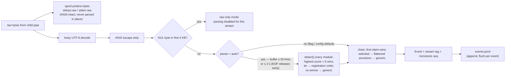
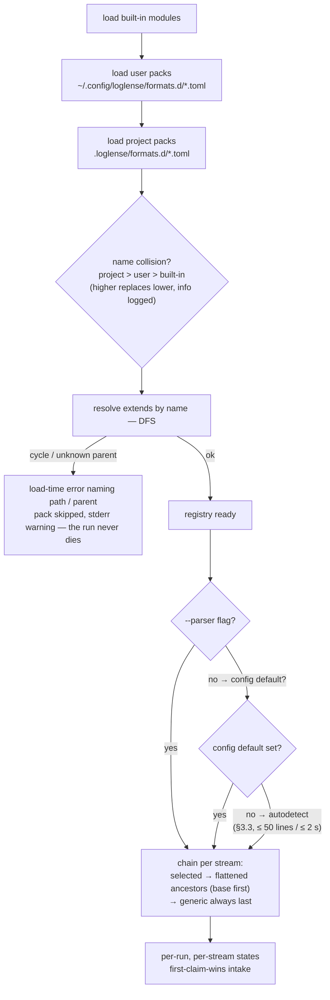

# loglense — Parser module system (spec)

Status: **spec (docs-first)** · Normative for `loglense-parsers` (framework, built-ins, pack loader) and for TOML pack authors. Companion: `architecture.md` §3 (module system) and §4.3 (parse-on-write pipeline) — this doc mirrors those and adds precision, never contradiction; `surfaces.md` covers the `parsers` CLI commands.

This file contains no code: schemas, grammars and contracts are expressed as tables, prose and mermaid diagrams only. Inline backticked identifiers are names, not code.

---

## 1. The Event model

Every module — compiled built-in or TOML pack — produces the same normalized event. The Event model is the only contract between parsers and every consumer (summary, dedup, CLI, MCP, golden fixtures). Events are appended to `runs/<id>/events.jsonl`, one JSON object per line, flushed per event.

### 1.1 Fields

| Field | Type | Present | Meaning |
|---|---|---|---|
| `seq` | number | always | monotonic sequence within the run (across both streams); stable ordering for consumers and fixtures |
| `ts_ms` | number | always | epoch milliseconds, set by the runner at capture time |
| `stream` | enum | always | which captured stream produced the event: `out` (stdout) or `err` (stderr) |
| `severity` | enum | always | `error` / `warning` / `notice` / `info` / `debug` |
| `kind` | enum | always | `line` / `phase` / `summary` / `test` — drives how consumers render and filter |
| `message` | text | always | human-readable content (captures interpolated for pack rules) |
| `template_id` | hash | optional | id of the normalized template used for dedup (digits→N, hex→H, quoted→S, path-like→P); links event → summary's top templates |
| `source` | object | optional | `file` (text), `line` (number), `module` (text) — populated when the format carries origin info (compiler diagnostics, tracebacks) |
| `lines` | list of numbers | always | raw 1-based line numbers in that stream's raw spool file that this event covers (navigation back into the spool) |
| `frames` | list of text | optional | attached stack-trace frames — one event per logical *block*, not per frame line |
| `phase` | text | optional | named build/test phase (e.g. maven reactor module names) |
| `test` | object | optional | `name` (text), `outcome` (e.g. passed / failed / error / skipped), `duration_ms` (number) |

### 1.2 Enums

| Enum | Values | Notes |
|---|---|---|
| severity | `error`, `warning`, `notice`, `info`, `debug` | ordered from worst to mildest; consumers filter with it |
| kind | `line`, `phase`, `summary`, `test` | `line` = default single/block line event; `phase` = named build phase marker; `summary` = run- or section-level verdict/totals; `test` = one test case outcome |

### 1.3 Compatibility rules

- Consumers **tolerate unknown fields**: an event with extra keys parses fine; consumers skip what they don't know. This keeps agents and golden fixtures forwards-compatible.
- The event grammar is versioned; `schema_version` travels in run metadata (`meta.json`), not per event. Current version: 1.
- The field set in §1.1 is the **agent-facing contract**: an agent may rely on exactly these fields and their meanings; anything beyond them is decoration.

### 1.4 Per-line pipeline

What happens to every captured line, per stream (mirrors `architecture.md` §4.3):

Notes on the chain step: one `ParseState` per module **per stream** — stdout and stderr blocks never interleave mid-block. While a module holds an open multi-line block, the next line is offered to that module first; a non-continuation line closes the block (the event is emitted) and then travels through the chain normally. A line no module claims falls through to `generic`, which claims everything.

---

## 2. The module contract

Every module — compiled or TOML pack — satisfies the same six-part contract (mirrors `architecture.md` §3.2):

| Contract element | Meaning |
|---|---|
| **Identity** | A unique name under which the module registers ("maven", "mytool"). |
| **Inheritance** | An optional parent, declared *by name* — the `extends` relation. Resolved at registry build time; cycles and unknown parents are load-time errors, never parse-time surprises. |
| **Detection** | A confidence score (0–100) computed over a sample of the run's first ~50 lines. Feeds autodetection (§3.3). |
| **Per-run state** | A fresh parsing state created for every run — and separately for every stream — so concurrent runs and streams never share mutable state. |
| **Line intake** | Lines arrive one at a time; the module may *buffer* while a multi-line block (stack trace, diagnostic) is open, emitting nothing until the block completes. |
| **Flush** | At end of stream, any still-open partial block is flushed as a best-effort event. |

**Statefulness is the key design point (D-005):** one event per *logical block* — a Java exception arrives as one event with its frames attached, not forty line-events. Summaries stay agent-sized even when stack traces are hundreds of lines.

The contract is declared once in `loglense-core` and satisfied identically by built-ins and packs. Its two interfaces, in table form:

| Interface member | Returns | Meaning |
|---|---|---|
| `name` | module name | identity: registry key, `--parser` value, `extends` target |
| `extends` | optional parent name | inheritance relation; `None` for standalone modules |
| `detect` | 0–100 confidence | scored over the detection sample (§3.3) |
| `new_run` | fresh per-run state | constructs the module's parsing state object |

| State member | Returns | Meaning |
|---|---|---|
| `feed` | list of events | one line in; a stateful module buffers while a block is open and emits when it completes; a stateless module returns immediately (0 or 1 events) |
| `finish` | list of events | end-of-stream flush of any still-open partial block (best-effort event) |

Format bases are stateless (immediate return); lang bases and tool parsers are stateful (block buffering). Both shapes use the same interface — statefulness is a property of the module, not of the contract.

---

## 3. Registry & resolution

### 3.1 Sources and precedence

| Source | Location | Notes |
|---|---|---|
| built-in | compiled into `loglense-parsers` | curated, fixture-tested (§5) |
| user pack | `~/.config/loglense/formats.d/*.toml` | per-user extensions |
| project pack | `.loglense/formats.d/*.toml` | committable — project-specific tools get project-specific packs in-repo |

On name collision the higher precedence **replaces** the lower with an info-level log: **project > user > built-in**. A project can intentionally shadow a built-in parser by shipping a pack with the same name. Packs may `extend` anything registered — built-in or pack.

### 3.2 `extends` resolution

- Name-based DFS at registry build time, never at parse time.
- Flattening produces an ordered rule chain: **base-most ancestor's rules first, each derived level next; a derived rule with a parent's rule id *overrides* the inherited rule** (same id = replacement, not duplication).
- The runtime chain for a selected parser is: selected parser → flattened ancestors (base first) → `generic` appended **always last**.
- Per stream, one state object per chain member (§1.4).

### 3.3 Detection algorithm (autodetect)

Parser selection precedence: **`--parser` flag > config default (`default_parser`) > autodetect**. Explicit selection skips the buffer entirely — no 2 s wait. When autodetect runs:

1. Per stream, the pipeline buffers parsed (stripped) lines until **50 lines** or **2 seconds** elapse — whichever comes first; EOF releases the buffer early so short runs are not delayed.
2. Every registered module's `detect` runs over the sample (≤ 50 lines).
3. Highest score wins; a score of 0 never wins. **Tie → registration order** (built-ins first, then packs in load order).
4. If nothing scores above 0, `generic` is selected — it is always eligible and the permanent last resort.
5. Pack-synthesized detection (§4): count sample lines matching `detect.pattern`; with `m` matches and threshold `min_score`, score is `0` when `m = 0`, else `min(100, ceil(100 · m / min_score))` — full confidence at `m ≥ min_score`.
6. Buffering delays *events*, never *capture*: raw bytes spool to the raw files from the first byte regardless.

### 3.4 Load-time errors and bad-pack policy

| Failure | Behavior |
|---|---|
| `extends` cycle | load-time error naming the full cycle path (e.g. `a → b → a`); offending pack skipped |
| unknown parent | load-time error naming both the missing parent and the child pack |
| bad regex in a rule | load-time error naming file, rule id and field, e.g. `pack.toml:rule[id=error-line].pattern: <regex error>` |
| unknown field | strict (`deny_unknown_fields`) error naming file + field |
| wrong `schema` value | rejected (currently only 1 is accepted) |

A **bad pack never kills a run**: it is reported to stderr as a warning naming the file and field, then skipped; the registry keeps everything else. Errors surface verbatim in `parsers validate` (§6).

### 3.5 Resolution flow

---

## 4. TOML pack grammar (schema = 1)

The no-recompile extension path (D-004). A pack is one TOML file dropped into a `formats.d` directory; the next `loglense` invocation loads it, autodetect starts considering it, and it may `extend` any registered module — inheriting, say, the full java stack-trace grammar for free.

### 4.1 Field table (complete)

| Section | Field | Type | Required | Meaning |
|---|---|---|---|---|
| header | `schema` | integer | yes | grammar version; must be exactly 1 — any other value rejected |
| header | `name` | text | yes | module name; the registry key; may intentionally shadow a built-in (§3.1) |
| header | `extends` | text | no | parent module name (built-in or pack); inheritance is by name |
| header | `description` | text | no | free-form human note; surfaced by `parsers list` |
| `detect` | `pattern` | regex (text) | yes, when `detect` present | line pattern whose repeated appearance identifies this format |
| `detect` | `min_score` | integer ≥ 1 | yes, when `detect` present | matching sample lines needed for full detection confidence (§3.3 item 5) |
| rule (ordered list) | `id` | text | yes | stable rule identifier; a derived rule with the same id *overrides* the inherited rule |
| rule | `severity` | enum | yes | one of error / warning / notice / info / debug |
| rule | `pattern` | regex (text) | yes | the line pattern to match — linear-time dialect only (§4.3) |
| rule | `message` | template | yes | event message; numbered-capture interpolation (§4.2) |
| rule | `kind` | enum | yes | one of line / phase / summary / test — drives consumer rendering |

The `detect` section as a whole is optional: a pack without it can still be selected explicitly (`--parser`, config default) but is never chosen by autodetect. `rule` entries form an **ordered list** — among the pack's own rules, earlier entries win; the pack's rules are evaluated *before* inherited base rules (derived sits ahead of ancestors in the chain, §3.2).

### 4.2 Capture interpolation

`message` is a template over the rule's own captures, using the regex crate's replacement syntax: `$1`, `$2`, … interpolate numbered capture groups (`$0` = whole match); `$$` is a literal dollar. Unmatched optional groups interpolate as empty text. Example semantics: a rule whose `pattern` captures the text after an error tag with group 1 and whose `message` is `$1` emits exactly that captured text as the event message.

### 4.3 Validation semantics

- **Strict**: `deny_unknown_fields` everywhere — unknown keys are rejected with a file + field error (typos fail loudly, not silently).
- **Linear-time regex dialect only**: patterns compile with the `regex` crate dialect — no backreferences, no lookaround, no catastrophic backtracking. This is what makes packs safe to load from project repositories.
- **Compile-at-load**: every rule's regex is compiled when the registry loads; a regex error is a load-time error naming file, rule id and field (§3.4) — it can never surface mid-run.
- `parsers validate` runs the exact same load path, load-only, and prints every error (§6).

### 4.4 Worked example — `mytool extends java` (table walkthrough)

The pack, field by field (a project file `.loglense/formats.d/mytool.toml`):

| Aspect | Setting |
|---|---|
| header | `schema` 1 · `name` mytool · `extends` java |
| detect | `pattern` `^mytool \[` · `min_score` 3 |
| rule 1 | id tool-error · severity error · pattern `^\[ERR\] (.+)$` · message `$1` · kind line |
| rule 2 | id build-failed · severity error · pattern `^mytool: BUILD FAILED in (\d+)s$` · message `build failed in $1 s` · kind summary |
| rule 3 | id test-failed · severity error · pattern `^mytool test ([\w/]+) \.\.\. FAILED$` · message `test $1 failed` · kind test |

**Resulting chain** (per stream): mytool rules (tool-error, build-failed, test-failed) → java base grammar (exception blocks, `Caused by` chains, `[ERROR]`/`[WARNING]`/`[INFO]` bracket prefixes — mytool does not override those) → generic last.

**What a sample run produces.** Given a mytool build log containing the lines below, detection counts three `^mytool \[` matches (≥ `min_score` 3 → full confidence, autodetect picks mytool), then:

| Log content (prose) | Claimed by | Resulting event |
|---|---|---|
| startup banner lines (`mytool [v2.1] …`) | detection evidence only; no rule matches | generic info, kind line, one event per line |
| `[ERR] connection refused (localhost:5432)` | rule 1 (tool-error) | severity error, kind line, message `connection refused (localhost:5432)` |
| a `java.lang.NullPointerException` header, three `at …(File.java:N)` frame lines, and a `Caused by:` line | inherited java block grammar (stateful) | **one** error event, message `java.lang.NullPointerException: …`, `frames` carrying the frame lines, `lines` covering the whole block, `Caused by` chain merged in |
| `mytool: BUILD FAILED in 12s` | rule 2 (build-failed) | severity error, kind summary, message `build failed in 12 s` |
| `mytool test auth/login ... FAILED` | rule 3 (test-failed) | severity error, kind test, message `test auth/login failed` |
| any other prose | nothing above | generic info, kind line |

This is the whole point of `extends`: the embedded NPE parsed with frames attached required **zero** stack-trace rules in the pack. Note the boundary: pack rules are single-line matches — they cannot attach `frames`, `source`, or a structured `test` object; those are populated by the stateful built-in grammars. A `kind = "test"` pack event still filters as a test event and carries the interpolated message; structured test fields on pack rules are post-v1 grammar work.

---

## 5. Built-in module inventory

### 5.1 Bases

| Module | Tier | Extends | State | Scope (one line) |
|---|---|---|---|---|
| `generic` | format base | — | stateless | always-last fallback: keyword severity on plain lines (error/fatal/panic/critical, warn, `error:`, `Exception`, `Traceback`, `FAILED`, `BUILD FAILURE` …); claims every unclaimed line; never fails |
| `json` | format base | — | stateless | one JSON object per line mapped via common keys (level/severity/lvl, msg/message, ts/time/timestamp, file/line/module, error); severity strings matched case-insensitively; non-JSON lines not claimed (fall through) |
| `logfmt` | format base | — | stateless | `key=value` token lines (quoted values allowed); `level=` / `msg=` / `time=` mapped like json's keys; non-matching lines not claimed |
| `java` | lang base | — | stateful | exception header grammar (`…Exception` / `…Error`, optional `: message`), `at pkg.Class(File.java:N)` frame lines, `... N more` terminators, `Caused by:` chains → one error event per block with frames; `[ERROR]`/`[WARNING]`/`[INFO]` bracket prefixes shared across JVM tools |
| `python` | lang base | — | stateful | `Traceback (most recent call last):` header + `File "path", line N, in func` frames + exception closer line (`…Error`/`…Exception`/`…Warning` with optional message) → one error event with frames; `logging` formats `LEVEL:name:message` (with and without timestamp) as severity lines |
| `rust` | lang base | — | stateful | rustc diagnostics: `error[E0xxx]: …` / `error: …` / `warning: …` headers, `--> path:line:col` source refs (→ `source`), code-context and `note:` / `help:` lines, `error: aborting due to N previous errors` summary; panic locations |
| `go` | lang base | — | stateful | `panic: …` header + `goroutine N [running]:` + `path/file.go:N +0x…` frame lines → one error event per block; `log.Print` style `2009/01/23 01:23:23.123 file.go:123: message` lines as info |

### 5.2 Tools

| Module | Extends | Scope (one line) |
|---|---|---|
| `maven` | `java` | maven-prefixed `[ERROR]` / `[WARNING]` / `[INFO]` / `[DEBUG]` rules (id-overriding the base bracket rules), `Tests run: X, Failures: Y, Errors: Z, Skipped: W` → kind test summary, `BUILD SUCCESS` / `BUILD FAILURE` → kind summary, `Reactor Summary` module lines → kind phase; embedded stack traces parse via the java base |
| `pytest` | `python` | `FAILED tests/…` / `PASSED` / `ERROR at setup/teardown` → kind test events (name, outcome), `=== short test summary info ===` section, `N failed, M passed in Xs` totals → kind summary, `INTERNALERROR`, warnings-summary blocks |
| `cargo` | `rust` | `Compiling` / `Finished` / `Running` phase lines, `test result: ok. N passed; M failed; …` totals → kind summary, `error: could not compile …`, panics parsed via the rust base extension |
| `gotest` | `go` | `--- FAIL: TestX (0.00s)` / `--- PASS:` → kind test events, `=== RUN` info lines, `FAIL  pkg  0.1s` / `ok  pkg` package summaries |
| `nix` | — (standalone) | nix builder `error:` blocks with `… from https://…` hint chains → error events, `warning:` blocks, trace lines; detect via `error:` plus nix vocabulary (derivation, builder, `/nix/store`) |

---

## 6. Authoring workflow

### 6.1 `parsers` commands

| Command | Purpose | Flags | Output |
|---|---|---|---|
| `parsers list` | show the registry | — | table of name, source (built-in / project / user), extends, loaded-or-warning per module |
| `parsers test <pack.toml>` | dry-run the pack (or any parser) over a sample file — the authoring loop | `--sample <file>` (required), `--parser <name>` (chain to exercise; default = the pack itself) | the events that would be emitted (table; `--json` for machine form), plus an `N lines unclaimed` info line; exit 0 |
| `parsers validate <pack.toml>` | load-only check | — | every error, `file:field`-precise (§3.4); exit 0 when clean |

### 6.2 Golden-fixture convention

| Aspect | Convention |
|---|---|
| location | `crates/loglense-parsers/tests/fixtures/<parser>/<case>.log` with sibling `<case>.expected.json` |
| case | the sample log plus the expected array of events |
| discovery | the golden runner walks the fixtures directory at **test runtime** (plain filesystem walk — no build-time codegen, stable across re-runs) |
| comparison | deep-equal against `expected.json`, ignoring `ts_ms`, `seq`, `template_id` |
| coverage | ≥ 4 cases per parser, including at least one negative case (things the parser must *not* claim) |
| promoted fixtures | `feedback promote` (see `surfaces.md`) copies raw lines into this exact layout; it writes an **empty expected array** — the test **fails until a maintainer fills it in** (fails-until-filled: every parse-miss becomes a red test before the fix) |

---

## 7. Cross-references

- `architecture.md` §3 (module system), §4.3 (parse-on-write pipeline), §8 (feedback loop) — this doc is their detailed spec.
- `surfaces.md` — `parsers list/test/validate` CLI contracts and the MCP surface.
- Decision records: D-003 (two-tier lang-first parsers), D-004 (TOML packs as the only external extension seam), D-005 (stateful per-block parsing).
