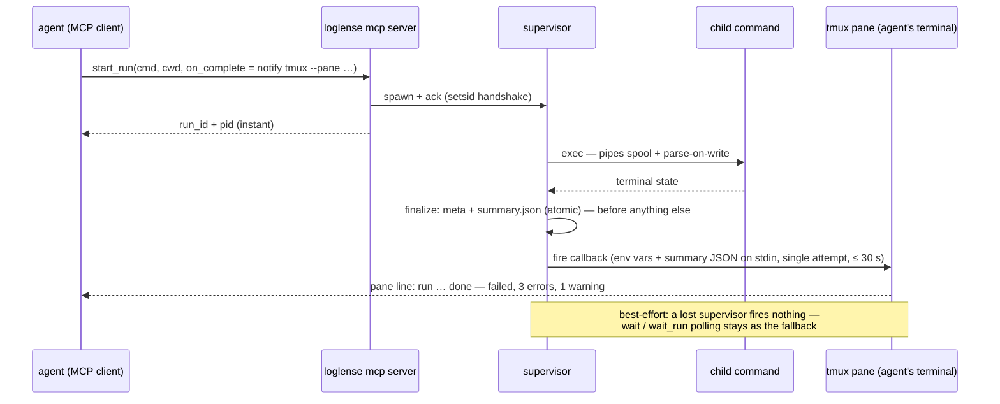

# loglense — CLI & MCP surface contracts

Status: **spec (docs-first)** · Normative for `loglense-cli` and `loglense-mcp`. Companion: `architecture.md` §6 (surface summary) and §7 (completion notification) — this doc is the full contract; `parsers.md` covers the parser module system.

No code in this file: every contract is a table, prose or mermaid diagram. Inline backticked identifiers are names, not code.

---

## 1. CLI conventions

### 1.1 Global flags

| Flag / env | Applies to | Meaning |
|---|---|---|
| `--dir <path>` | all subcommands | use this `.loglense` store instead of walk-up discovery (short-circuits discovery entirely) |
| `LOGLENSE_STATE_DIR` (env) | all subcommands | same override as `--dir`; flag wins when both are set |
| `--json` | any subcommand that prints results | machine-readable output (shapes per subcommand below); read commands are the primary consumers |

### 1.2 Prefix dispatch and the reserved set

`loglense <cmd...>` is the time-style form: when the first argument is **not** a reserved subcommand, the CLI behaves as `run` with all arguments as the command. Reserved first arguments: `run`, `init`, `ls`, `show`, `errors`, `warnings`, `tail`, `wait`, `kill`, `gc`, `parsers`, `feedback`, `notify`, `mcp` (plus `help` and `version`).

**Ambiguity note:** to wrap a literal command whose own name starts with a reserved word (a binary actually called `run`, `show`, …), use the explicit form `run -- <cmd...>` — everything after `--` is the command, never a subcommand.

### 1.3 Bounded output (hard invariant)

Every read surface is bounded by default; caps protect agent context windows. `show` returns ≤ 20 error templates; `errors` / `warnings` ≤ 50 events; `tail` ≤ 100 lines; `ls` ≤ 50 runs. `--max` overrides the cap on `ls` / `show` / `errors` / `warnings`; `--lines` overrides it on `tail`. No read is ever unbounded.

### 1.4 Exit-code matrix (agent-facing contract)

Agents branch on exit codes — they are contract, not convention:

| Code | Meaning | Produced by |
|---|---|---|
| 0 | ok — requested operation succeeded | every subcommand on success; `wait` when the observed run ends with a successful outcome |
| 1 | run outcome failed — the wrapped command exited non-zero (or was signaled) | `wait` mirroring the run's outcome; never used for loglense's own failures |
| 2 | usage error, unknown id, or corrupt run — bad flags/arguments; unknown run or feedback id; unreadable store records (corrupt runs are warned and skipped, the rest still lists) | any subcommand on these conditions |
| 124 | wait timeout — the run was still live when `--timeout` elapsed | `wait` only |

MCP tools have no process exit codes; the same outcomes travel as result fields (`timed_out`, error text).

---

## 2. CLI subcommands

| Subcommand | Purpose | Arguments | Key flags | Default cap | `--json` shape |
|---|---|---|---|---|---|
| `run` | wrap a command: spawn detached supervisor, print id + pid, return instantly (exit 0) | `-- <cmd...>` | `--parser <name>` · `--on-complete <cmd>` · `--on-complete-timeout <ms>` | instant return | object with `run_id`, `pid`, run dir |
| `init` | create `.loglense/` in CWD, write its self-ignore file, append `.loglense/` to the repo `.gitignore` when in a git repo and the line is absent; prints every action; idempotent | — | `--force` (allow creating directly in `$HOME` or `/`) | — | object with `state_dir` and `actions` (each `action` created / exists / appended / unchanged / skipped, `path`, `detail`) |
| `ls` | list runs newest-first (derived liveness: orphaned/lost shown as interrupted family); corrupt runs warn on stderr and are skipped | — | `--max` · `--status` (starting, running, exited, signaled, failed-to-start, interrupted, orphaned, lost) | 50 runs | object with `runs` (rows of `run_id`, `status`, optional `derived`, `cmd_head`, `age_s`, optional `exit_code`, optional severity `counts` once finished), `total`, `shown` |
| `show` | one run: meta + summary + top deduped error/warning templates, errors first (+ callback result and `callback.log` tail when present) | `<run-id>` | `--max` | 20 templates | object with `meta`, `state`, `summary` (without its template list), `templates` |
| `errors` | error events of a run, oldest first | `<run-id>` | `--max` | 50 events | object with `events`, `total`, `shown` |
| `warnings` | warning events of a run | `<run-id>` | `--max` | 50 events | same shape as `errors` |
| `tail` | last lines of a run's captured output (raw spool); `merged` (default) interleaves both streams in arrival order — exact up to pipe-read granularity (D-007, D-017) | `<run-id>` | `--stream out\|err\|merged` · `--lines` | 100 lines | object with `lines` (each `stream`, raw `line`, `text`), `truncated` |
| `wait` | block until a run reaches a terminal state, a derived dead substate, or timeout (§3) | `<run-id>` | `--timeout <seconds>` (omitted = no timeout) | poll 250 ms | object with `status`, optional `exit_code`, `timed_out` |
| `kill` | terminate a run: signals the child process group after supervisor-liveness and pid-reuse checks; prints what was signaled; clean refusal on starttime mismatch or already-terminal run (already-terminal exits 0; a refusal — lost run, pid reuse, corrupt meta — exits 2) | `<run-id>` | — | — | object with `run_id`, `action`, `status`, `detail` |
| `gc` | delete old runs (flock-serialized; never touches live-supervisor runs; rename-to-trash then delete) | — | `--max-age <days>` · `--max-total <MB>` (defaults from config: 14 days / 2048 MB) | — | object with `runs_removed`, `bytes_freed` |
| `parsers` | authoring suite — see §2.1 | — | — | — | — |
| `feedback` | agent-feedback suite — see §2.2 | — | — | — | — |
| `notify` | ping adapters, designed to run **as** an `--on-complete` callback target — see §4.3 | — | — | — | small adapter-specific object |
| `mcp` | start the stdio MCP server (§5) | — | — | — | no output — protocol on stdio |

`tail` has no follow/watch mode in v1 — a `--follow` flag is rejected with a clear error rather than approximated.

Every printed message or line is additionally capped at 4096 bytes (marked with the number of bytes cut) and every event at 20 frames, so a single pathological line cannot flood an agent context even within the item caps.

### 2.1 `parsers` subcommands

| Command | Purpose | Output |
|---|---|---|
| `parsers list` | registry contents: built-ins, user packs (`~/.config/loglense/formats.d/`), project packs (the discovered store's `formats.d/`) | table: name, source (built-in/project/user), extends, `loaded` or `broken: <error>` |
| `parsers test [<pack.toml>]` | dry-run a pack (or `--parser <name>` chain; both → the pack is registered and the named chain runs) against `--sample <file>`; `--max` caps shown events (200) | chain order, events it would emit, and `N lines unclaimed` — lines that fell through to `generic`; exit 0 (an unloadable pack exits 2) |
| `parsers validate <pack.toml>` | load-only: file/TOML/schema errors stop the check; otherwise the detect block and **every** rule pattern are checked, each error file:field-precise (`pack.toml:rule[id=…].pattern: …`) | clean/dirty verdict + error list; exit 0 when clean, 2 when dirty |

### 2.2 `feedback` subcommands

| Command | Purpose | Output |
|---|---|---|
| `feedback leave <run-id>` | record an agent report (`--kind` parse-miss/false-positive/bug/feature/other · `--detail` text · optional `--line N`, `--expected <severity>`, `--snippet`) | prints feedback id `f-<ts>-<seq>` |
| `feedback list` | this project's records (`--status open\|fixed\|wontfix`, `--max` 50); `--global` walks the cross-project index and marks dangling pointers as orphans | record rows (`feedback_id`, `status`, `kind`, `run_id`, `detail` or `path`, `orphan`), `total`, `shown` |
| `feedback show <fid>` | one record | full record |
| `feedback promote <fid>` | copy the referenced raw lines (around the reported line ± 20; lines 1–21 when the record has no line) into `crates/loglense-parsers/tests/fixtures/<parser>/<fid>.log` + sibling `<fid>.expected.json` containing an **empty array** (fails-until-filled). The checkout is `--repo`, else `LOGLENSE_REPO`, else the working directory; `--stream out\|err` picks the spool (default: stdout when it reaches the line); `--parser` names the fixture dir when the record has none; existing fixtures are never overwritten without `--force` | prints the exact `cargo test` command to run and reminds to fill expected; a missing spool or non-checkout exits 2 naming what is missing |
| `feedback resolve <fid>` | `--status fixed\|wontfix`, optional `--note` | updated record |

---

## 3. The `wait` contract

`wait` (and its MCP twin `wait_run`) never make an agent burn a timeout on a dead run.

| Aspect | Contract |
|---|---|
| Result | object with `status` (terminal: exited / signaled / failed-to-start — or a derived dead substate — or `running` only on timeout), `exit_code` present exactly when the child exited, and `timed_out` boolean |
| Polling | CLI polls run meta every **250 ms**; MCP `wait_run` polls every 100 ms |
| Fast-fail | before waiting, derived liveness is computed: if the supervisor is dead and the child is alive (`orphaned`) or both are dead (`lost`), `wait` returns **immediately** with the interrupted substate instead of polling to timeout |
| Timeout | `--timeout <seconds>`; when it elapses with the run still live → exit **124**, `timed_out: true` (MCP: `timed_out: true`, no exit code) |
| Exit mirror | on terminal states, `wait` mirrors the run outcome: child exit 0 → 0; child non-zero / signaled → 1 (matrix §1.4) |
| MCP bounds | `wait_run` `timeout_ms` defaults to **10000** and is hard-clamped server-side to **120000** ms (larger values are clamped, not rejected) |

---

## 4. Completion callback contract

Per `architecture.md` §7 (D-011): push beats poll — the supervisor itself pings the agent when results are ready. Polling stays the always-available fallback.

### 4.1 Requesting

| Surface | How |
|---|---|
| CLI | `--on-complete <cmd>` on `run` (and the prefix form), optional `--on-complete-timeout <ms>` (default 30000; only valid together with `--on-complete`) |
| MCP | `on_complete` and `on_complete_timeout_ms` params on `start_run` |

The callback spec is stored in run meta at spawn time. The command string runs via `sh -c` in the run's working directory, in its own process group (a timeout kills the whole group).

### 4.2 Execution semantics

| Aspect | Contract |
|---|---|
| Trigger | any terminal state: exited, signaled, or failed-to-start |
| Ordering | run finalization **always precedes** the callback: `meta.json` and `summary.json` are atomically written first — a failing or hanging callback can never corrupt the run record; the callback *result* is recorded via a second atomic summary update after the callback completes |
| Context | environment variables (table below) + the full summary JSON on the callback's standard input |
| Execution | detached, **single attempt**, bounded by the timeout (default 30 s) |
| Observability | captured stdout + stderr land in `runs/<id>/callback.log`, bounded **≤ 64 KB** (the rest is drained and noted as dropped); the result is recorded in the summary as `callback` (`ok` = exit 0, `failed` = non-zero exit / signal / spawn failure, `timeout`) plus a human `callback_detail` (`exit 0`, `exit 127`, `killed after 500 ms`, …). `show` / `get_run` display both and the last ≤ 4 KB of `callback.log` (`callback_log`) |
| Guarantee | best-effort by construction: the callback fires only when the supervisor survives to the terminal state; a lost run fires **nothing** — `wait` / `wait_run` polling is the fallback path |
| Trust | same trust level as the wrapped command itself — the caller already controls what runs; callbacks add no new privilege |

| Env var | Value |
|---|---|
| `LOGLENSE_RUN_ID` | the run id |
| `LOGLENSE_STATUS` | terminal status (exited / signaled / failed-to-start) |
| `LOGLENSE_EXIT_CODE` | child exit code — present only when the child exited |
| `LOGLENSE_STORE_PATH` | absolute path of the `.loglense` store root |

### 4.3 `notify` adapters

`loglense notify` subcommands exist to be used **as** the callback target:

| Adapter | Invocation | What it pings |
|---|---|---|
| tmux (built-in) | `notify tmux --pane <target>` (optional `--msg-fmt`, `--no-enter`) | types a one-line completion message into a tmux pane (literally, via `send-keys -l`) and presses Enter — TUI agents living in tmux literally receive the line as input. Default line: `loglense: run <id> <status> (exit <code>, <E> errors, <W> warnings)`. Message fields are fixed: `{id}`, `{status}`, `{exit}`, `{errors}`, `{warnings}`; `--msg-fmt` may rearrange exactly these, any other `{…}` is rejected (the callback then records `failed`), and control characters are replaced so the message is always one line. Outside a callback (no `LOGLENSE_RUN_ID`) it exits 2 with an explanation |
| exec (built-in) | `notify exec -- <cmd>` | runs any command with the full callback context (env vars + summary JSON on stdin) inherited unchanged and exits with its code — harness CLIs, custom integrations |
| webhook (recipe, not built-in) | an exec callback invoking `curl` | POSTs the summary JSON (read from the callback's stdin) to a URL with a ~10 s limit. Kept a documented recipe so the static binary's dependency list stays frozen — no HTTP client ships in the binary |

---

## 5. MCP server (`loglense mcp`)

### 5.1 Diagnostics discipline

- **stdout carries only protocol frames** (JSON-RPC). A single stray print corrupts the stream — all warnings, tracing and diagnostics go to **stderr**.
- A panic in a tool handler must never abort the server: failures return as tool errors; the server keeps serving.
- Transport: stdio; eight tools, exactly the set below — no notifications, no streaming (wait_run is poll-based by design).
- Every tool returns its result twice: as structured content and as the same JSON pretty-printed in a text block. Failures (unknown run, bad argument, corrupt run) are **tool errors** — structured content with an `error` message — never transport errors; the connection stays usable.
- A client that closes stdin before initializing (`loglense mcp < /dev/null`) is a clean exit (code 0).

### 5.1a Locating a run's store

Run-scoped tools (`get_run`, `get_events`, `get_log`, `wait_run`, `kill_run`, `leave_feedback`) take `run_id` plus an **optional** `cwd`. With `cwd`, the run is looked up in that project's store. Without it, the server looks in `LOGLENSE_STATE_DIR` (when set) and in the stores it already resolved for earlier `start_run` / `list_runs` calls (bounded memory: 64 stores, 4096 runs); an unseen run yields a tool error telling the agent to pass `cwd`. `LOGLENSE_STATE_DIR`, when set in the server's environment, overrides discovery for every tool, as it does for the CLI.

### 5.2 Tools

#### `start_run`

| Param | Type | Required | Default | Bounds / notes |
|---|---|---|---|---|
| `cmd` | array of strings | yes | — | the command argv to wrap |
| `cwd` | string | yes | — | **absolute project dir** — store discovery runs from here, never from the server's own CWD (§5.3) |
| `parser` | string | no | auto | module name; omit for config default / autodetect |
| `on_complete` | string | no | — | callback command (§4) |
| `on_complete_timeout_ms` | integer | no | 30000 | |

Result: object with `run_id` (text), `pid` (integer, the wrapped child) and `run_dir`. `cwd` must be absolute and an existing directory; the command runs there.

#### `list_runs`

| Param | Type | Required | Default | Bounds |
|---|---|---|---|---|
| `status` | enum | no | all | filter by status family (incl. derived interrupted substates) |
| `limit` | integer | no | 50 | server clamps to ≤ 200 |
| `cwd` | string | yes | — | explicit project dir — same trap as `start_run` |

Result: object with `runs` (rows of `run_id`, `status`, optional `derived`, `cmd_head` (first token of the command), `age_s`, optional `exit_code`, severity `counts` once finished), `total` and `shown` — the same rows as CLI `ls --json`.

#### `get_run`

| Param | Type | Required | Default |
|---|---|---|---|
| `run_id` | string | yes | — |
| `cwd` | string | no | — (see §5.1a) |

Result: object with `meta` (full run meta), `state` (terminal status, `running`, or derived `orphaned` / `lost`), `summary` (terminal summary without its template list, incl. callback result when present; absent while live), `templates` (top deduped error/warning templates, errors first — ≤ 20, with severity, count, first/last seen, example).

#### `get_events`

| Param | Type | Required | Default | Bounds |
|---|---|---|---|---|
| `run_id` | string | yes | — | |
| `severity` | enum | no | all | error / warning / notice / info / debug |
| `kind` | enum | no | all | line / phase / summary / test |
| `limit` | integer | no | 100 | server clamps to ≤ 1000 |
| `offset` | integer | no | 0 | skip this many matching events (events are in file order, oldest first) |
| `cwd` | string | no | — | see §5.1a |

Result: object with `events` (event array, §1 of `parsers.md`; messages capped at 4096 bytes, ≤ 20 frames each), `total` (matching count, unpaginated) and `shown`.

#### `get_log`

| Param | Type | Required | Default | Bounds |
|---|---|---|---|---|
| `run_id` | string | yes | — | |
| `stream` | enum | no | out | out / err / both (both = arrival order, D-017) |
| `tail_n` | integer | no | 100 | server clamps to ≤ 10000 |
| `from_line` | integer | no | — | 1-based raw line; when set, return up to `tail_n` lines starting there instead of the last `tail_n`; requires `out` or `err` (line numbers are per stream) |
| `cwd` | string | no | — | see §5.1a |

Result: object with `lines` (each `stream`, raw `line`, `text` capped at 4096 bytes) and `truncated` (boolean: lines outside the returned slice exist).

#### `wait_run`

| Param | Type | Required | Default | Bounds |
|---|---|---|---|---|
| `run_id` | string | yes | — | |
| `timeout_ms` | integer | no | 10000 | **hard server-side clamp 120000** |
| `cwd` | string | no | — | see §5.1a |

Result: object with `status`, `exit_code` (when exited), `timed_out`. Polls meta every 100 ms; fast-fails on orphaned/lost exactly like CLI `wait` (§3).

#### `kill_run`

| Param | Type | Required | Default |
|---|---|---|---|
| `run_id` | string | yes | — |
| `cwd` | string | no | — (see §5.1a) |

Result: object with `run_id`, `action` (signaled / already-terminal / refused), `status`, `detail`. Same liveness and pid-reuse guards as CLI `kill`.

#### `leave_feedback`

| Param | Type | Required | Default | Notes |
|---|---|---|---|---|
| `run_id` | string | yes | — | |
| `kind` | enum | yes | — | parse-miss / false-positive / bug / feature / other |
| `detail` | string | yes | — | free text |
| `line` | integer | no | — | raw line the feedback refers to |
| `expected_severity` | enum | no | — | what the agent expected (e.g. a parse-miss that should have been error) |
| `snippet` | string | no | — | quoted log fragment (capped at 4096 bytes) |
| `cwd` | string | no | — | see §5.1a |

Result: object with `feedback_id`. The record lands in the project store and is mirrored to the global cross-project index (see `feedback leave`, §2.2).

### 5.3 `.mcp.json` wiring

| Key | Value | Notes |
|---|---|---|
| `command` | `loglense` | or the absolute path to the binary if it is not on PATH |
| `args` | array containing exactly `mcp` | boots the stdio server |

**The cwd trap:** MCP servers are commonly launched from `$HOME`, not from the project the agent is working in. Store discovery walks up from the *process* CWD — run from `$HOME` it would find (or worse, create) the wrong store. This is exactly why `start_run` and `list_runs` take an **explicit required `cwd`**: the agent names the project directory, and discovery runs from there. Never rely on the server's own CWD.

---

## 6. Notification sequence (MCP path)

---

## 7. Cross-references

- `architecture.md` §6 (surface summary table), §7 (completion notification) — this doc is their full contract.
- `parsers.md` — event model (consumed by `get_events` / `show` / fixtures), `parsers` suite, fixture convention.
- Decision records: D-008 (single binary = CLI + MCP), D-011 (supervisor-fired callbacks + adapters).
